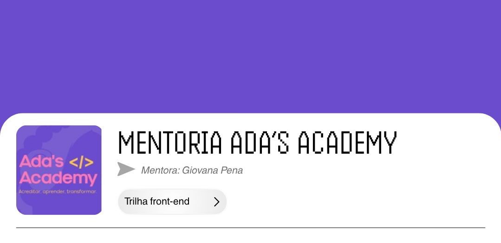

---

## 👩‍💻 Sobre este repositório

Este repositório reúne o registro da minha jornada na **Mentoria Adas**: o que estudei a cada semana, os exercícios e projetos desenvolvidos, as reflexões de cada mês e os resultados alcançados. Ele funciona como diário de bordo e também como parte do meu portfólio.

Sou estudante de **Análise e Desenvolvimento de Sistemas (IFRN)**, **Técnica em Informática  (IFRN)**,  aluna pesquisadora na área de **Modelagem de Sistemas Cíberfísicos**, e atualmente estagiária na **Secretaria de Estado da Infraestrutura do Rio Grande do Norte (SIN/RN)**. Na mentoria, busquei fortalecer os fundamentos de Front-End, avançar no Back-End e ganhar maturidade técnica para atuar como desenvolvedora de software.

---

## 📋 Informações da mentoria

| Campo | Registro |
|---|---|
| **Mentoria** | Adas Academy - Turma 1|
| **Mentora** | Giovana Pena |
| **Período** | `Preencher: data de início – data de término` |
| **Duração** | 6 meses |
| **Área** | Desenvolvimento Fullstack (Web) |
| **Formato de feedback** | Detalhado e em etapas |
| **Objetivo geral** | Desenvolver competências Fullstack, fortalecendo o Front-End, aprofundando o Back-End e construindo um projeto completo para portfólio |

---

## 🎯 Objetivos da mentoria

### Metas de curto prazo (3–6 meses)

- [x] Aprimorar fundamentos de Front-End (HTML semântico, CSS, responsividade e acessibilidade)
- [x] Consolidar a lógica de programação com JavaScript moderno
- [ ] Consolidar React (props, state, hooks e router)
- [ ] Desenvolver uma aplicação Fullstack completa (React, API e banco de dados)
- [x] Melhorar o uso de Git e GitHub
- [ ] Ganhar autonomia na leitura de documentações técnicas

### Metas de longo prazo (1–3 anos)

- Sentir segurança para produzir soluções Fullstack
- Concluir a graduação e atuar de forma efetiva na área

---

## 🗓️ O que foi trabalhado por mês

| Mês | Semanas | Temas trabalhados | Principais entregas |
|---|---|---|---|
| **1** | 1 a 4 | HTML semântico, acessibilidade e SEO básico • CSS (box model, display e posicionamento) • Responsividade e layout • Lógica de programação com JavaScript | `Preencher` |
| **2** | 5 a 8 | Functions, callbacks e promises • DOM + API • Python para Backend • Introdução ao Django | `Preencher` |
| **3** | 9 a 12 | Apresentação, posicionamento e carreira | `Preencher` |
| **4** | 13 a 16 | Comunicação e postura em uma equipe de desenvolvimento | `Preencher` |
| **5 e 6** | 17 a 24 | Acompanhamento dos meus projetos acadêmicos | `Preencher` |

---

## 📂 Semanas com material no repositório

| Semana | Tema | Pasta |
|---|---|---|
| 1 | HTML Semântico, acessibilidade, SEO básico e Lógica de Algoritmo | [📁 semana-1](./semana1) |
| 2 | CSS: Box Model, Display e Posicionamento | [📁 semana-2](./semana2) |
| 3 | Responsividade e layout | [📁 semana-3](./semana3) |
| 4 | Lógica de Programação com JavaScript | [📁 semana-4](./semana4) |
| 5 | Functions, callbacks e promises | [📁 semana-5](./semana5) |
| 6 | DOM + API | [📁 semana-6](./semana6) |
| 7 | Python para Backend | [📁 semana-7](./semana7) |

> 📝 As demais semanas não possuem pasta neste repositório, mas foram registradas na tabela mensal acima.

---

## 📊 Indicadores de progresso

| Indicador | Meta inicial | Resultado / evidência |
|---|---|---|
| Semanas concluídas | `Preencher` | 9 semanas concluídas no quadro de acompanhamento |
| Projetos concluídos | `Preencher` | `Preencher` |
| Conceitos praticados | HTML, CSS, JavaScript, React, Back-End | HTML/CSS, JavaScript assíncrono, DOM + API, Python e Django |

---

## ✅ Objetivos alcançados

- [x] Revisão e fortalecimento dos fundamentos de HTML, CSS e JavaScript *(semanas 1 a 6)*
- [x] Melhor domínio dos conceitos de Front-End: responsividade, layout e acessibilidade *(semanas 1 a 3)*
- [x] Contato com Back-End usando Python e Django *(semanas 7 e 8)*
- [x] Trabalho de apresentação, posicionamento profissional e carreira *(semana 10)*
- [x] **Vaga de estágio em um órgão público**

---

## 💡 Lições aprendidas e reflexão final

- **Conquista de que mais me orgulho:** conseguir uma vaga de estágio em um órgão público.
- **Habilidades que desenvolvi:** comunicação.
- **Maior desafio e como lidei com ele:** ter muita demanda e pouco tempo para gerenciar tudo.
- **O que faria diferente:** focar em um caminho mais linear.
- **Lições aprendidas:** Fazer um pouco todos os dias é mais proveitoso do que muito em um único dia e nada por muitos dias.

---

## 📚 Materiais e referências

### Projeto ou entregas de destaque

| Projeto | Descrição | Materiais e links |
|---|---|---|
| **Marias** | Sistema web de apoio psicológico a mulheres vítimas de violência. (Disponível nesse repositório apenas algumas documentações: o projeto completo ainda está sendo desenvolvido em um repositório privado). | &bull; [Documento de visão](./projeto_marias_doc/doc-visao.md) &bull; [CDU 01 — Solicitar ser paciente](./projeto_marias_doc/cdu-01/detalhamento-01.md) &bull; [CDU 06 — Dar feedback de serviço](./projeto_marias_doc/cdu-06/detalhamento-06.md) &bull; [CDU 08 — Analisar solicitações](./projeto_marias_doc/cdu-08/detalhamento-08.md) &bull; [CDU 12 — Analisar justificativas](./projeto_marias_doc/cdu-12/detalhamento-12.md) &bull; [Diagrama de casos de uso](./projeto_marias_doc/marias_CDUs.png) &bull; [Diagrama de classes](./projeto_marias_doc/Marias_ClassDiagram.png) &bull; [Diagrama de sequência — Solicitar ser paciente](./projeto_marias_doc/SequenceDiagram_Solicitar-Ser-Psi.png) |
| **Jarvis: Modelagem de um Sistema Ciberfísico com AADL** | Meu projeto de pesquisa na área da robótica, onde estudei análise e modelagem de sistemas ciberfísicos com AADL. | &bull; [Artigo aprovado na Expotec 2026 do IFRN Campus Natal Central](./jarvis-pesquisa/Resumo_Expandido_Expotec2026_Jarvis.pdf) &bull; [Avaliações do artigo](./jarvis-pesquisa/avaliações-artigo.png) |
| **Leides Artes** | Catálogo digital para minha loja de personalizados | &bull; [Link do repositório do projeto](https://github.com/jenniferdomgs/catalogoLeides) |

---
